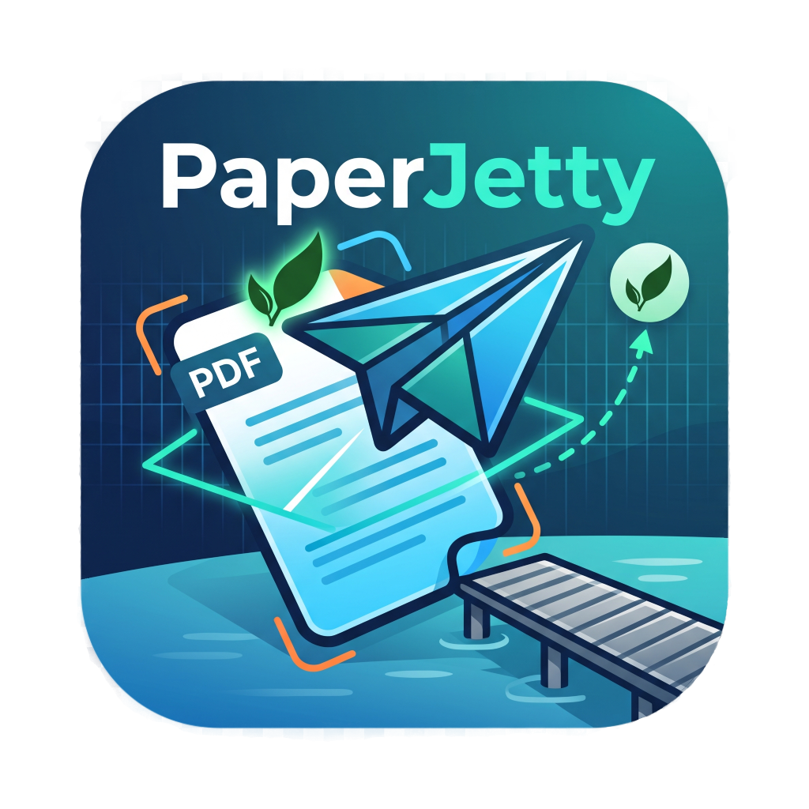

# PaperJetty



**Scan on your phone. Review your pages. Send them to your own archive.**

PaperJetty (formerly DocuScan) is a self-hosted document scanner for your mobile browser. Capture documents, adjust corners, enhance and rotate pages, then download PDFs or upload them to Paperless-ngx. No native app installation is required.

[](https://github.com/tipp88/PaperJetty/releases/tag/v1.4.2)
[](https://github.com/tipp88/PaperJetty/releases)
[](https://github.com/tipp88/PaperJetty/issues)
[](LICENSE)

- Automatic or manual capture, with selection of the sharpest suitable frame from a short burst.
- Multiple pages per document, editable document queue, titles and tags.
- PDF download and batch upload to Paperless-ngx, with page rotation preserved.
- Processing in your browser and on your server. OCR and archiving are handled by Paperless-ngx.

The latest stable release is **1.4.2**. Docker images are publicly available as `ghcr.io/tipp88/paperjetty`; no registry login is required to pull them.

## Docker setup

Requires Docker with Compose on a **Linux amd64** host and a phone browser with camera access. ARM images are not currently published. Save this as `compose.yaml`:

```yaml
services:
  paperjetty:
    image: ghcr.io/tipp88/paperjetty:latest
    restart: unless-stopped
    ports:
      - "8443:443"
    volumes:
      - ./data:/app/data
    healthcheck:
      test: ["CMD", "curl", "-fk", "https://localhost/health"]
      interval: 30s
      timeout: 10s
      retries: 3
      start_period: 40s
```

```bash
docker compose up -d
```

Open **`https://YOUR-SERVER-IP:8443`** on your phone. The bundled certificate is self-signed and browsers may warn or refuse camera access. For reliable use, provide a certificate trusted by your phone or use an HTTPS reverse proxy. Custom certificates can be mounted at `/app/ssl/paperjetty.crt` and `/app/ssl/paperjetty.key`. Keep your chosen URL consistent so the browser can find its saved queue.

In **Settings**, enter your Paperless-ngx URL, API token and default tags. Use an address reachable from the container; `localhost` inside the container is not your Paperless server. Paperless is optional for PDF downloads.

**Access:** Use a trusted LAN/VPN or an authenticated reverse proxy covering both the app and `/api`. There is no built-in login or user separation; connected clients can read shared settings, including the Paperless token. Do not expose the app directly to the public internet.

## Scan and edit

1. Capture a page and adjust its corners. Choose **Add Page** to continue the document, or **Finish Doc & New** to put it in the queue.
2. In **Queue**, use **Edit** to rotate, replace, remove, enhance or reorder pages. **Save to Queue** keeps the title and tags. Another active document is saved to the queue before switching.
3. Download a PDF or upload the queue to Paperless-ngx.

**Storage:** Settings are shared and stored in `./data`. Active pages and queued documents are stored in **IndexedDB in that browser**, not in the server volume. Clearing site data, changing the origin or using another browser does not preserve/access that queue. Download or upload important scans before clearing browser data. PDF export and uploads require the server; this is not a fully offline app. The UI loads fonts from Google Fonts; document images are not sent to that service.

## Update

From the directory containing `compose.yaml`:

```bash
docker compose pull
docker compose up -d
```

Keep the same volume and browser URL. Back up `./data` (it contains credentials), and finish or download queued scans before maintenance. Do not use `down -v` when relying on named volumes. When migrating an existing `docker run` installation, reuse its `/app/data` host directory instead of creating a fresh one.

When replacing the old service with `paperjetty`, run `docker compose down` using the old configuration first, without `-v`, then start the new configuration. Keep the same `./data` directory and browser URL. If using the standalone recipe with existing named volumes, set `name: YOUR_EXISTING_VOLUME_NAME` under each new top-level volume entry (`paperjetty-data` and `paperjetty-logs`) to reuse the old volumes. Keep the Compose project name unchanged during this switch, or stop the old project explicitly before changing it. When upgrading from 1.4.1 or earlier with custom certificates, update the container-side mount paths to `/app/ssl/paperjetty.crt` and `/app/ssl/paperjetty.key`.

Use `:1.4.2` instead of `:latest` to pin a release, or `:dev` to test upcoming changes. Change any old image reference to `ghcr.io/tipp88/paperjetty` for future updates. Troubleshooting: `docker compose logs --tail=100`; check HTTPS and browser permissions for camera errors, and container connectivity/token settings for upload errors. Capture quality depends on lighting, focus and browser/device support.

## Changelog

### [Unreleased]

### [1.4.2] - 2026-11-17

- Match navigation, buttons, focus rings, progress indicators and scan/crop overlays to the logo's cyan and turquoise palette.
- Replace the old yellow navigation logo with the full PaperJetty PNG, matching the app icon and favicon.
- Rename Compose service, container, network and volume names to PaperJetty and update Docker command examples.
- Complete the rename across certificate paths, nginx, setup scripts, Compose project defaults and default upload tags; use `PAPERJETTY_SETTINGS_FILE` for configuration. Existing saved settings and browser scans are preserved.
- Publish future Docker images only under `ghcr.io/tipp88/paperjetty`; update old image references before upgrading.

### [1.4.1] - 2026-11-17

- Rename the app to PaperJetty, add an app icon and MIT license.
- Use the full PaperJetty PNG logo in this README, as the app icon and favicon.
- Consolidate installation, updates and version history into this README; remove obsolete setup/status guides.
- Persist settings in the standalone Compose recipe, correct its image reference and HTTPS health check, and exclude local analysis tools from Docker builds.
- Keep existing image addresses, settings paths, default tags and browser storage keys compatible.
- Move the repository to PaperJetty and publish Docker images under both `paperjetty` and the legacy `docu_scan` name.

### [1.4.0] - 2026-11-17

- Edit queued documents, preserve titles/tags across reloads and save unfinished documents before switching.
- Preserve page rotation in queue previews, PDF downloads and Paperless uploads.
- Check release metadata before Docker publishing; backfill missing release history.
- Includes previews **1.3.12-dev.1** (rotation fixes) and **1.3.12-dev.2** (queue editing), both tested on 2026-11-17. No stable 1.3.12 was released.

### [1.3.11] - 2026-10-16

- Add auto/manual capture controls and clearer capture hints.
- Request continuous focus, exposure and white balance when supported; fix camera lifecycle and permission errors.
- Publish a separate `dev` Docker image. Document an Adobe Scan investigation; no Adobe scanner code or models are included.

### [1.3.10] - 2026-10-16

- Select the sharpest suitable capture frame, with matching crop corners and movement checks.
- Remove the absolute sharpness threshold that blocked capture; tolerate normal hand drift and slow cameras.

<details>
<summary>Earlier versions</summary>

| Version | Date | Changes |
| --- | --- | --- |
| 1.3.9 | 2026-07-08 | Honor the default enhancement selected in Settings. |
| 1.3.8 | 2026-06-18 | Fix perspective distortion, corner ordering and high-resolution memory failures. |
| 1.3.7 | 2026-06-11 | Improve mobile viewport spacing and control accessibility. |
| 1.3.6 | 2026-06-11 | Improve confidence and capture margins for long receipts. |
| 1.3.5 | 2026-06-11 | Improve receipt boundaries and temporal stability; move storage to IndexedDB. |
| 1.3.4 | 2026-06-11 | Add multi-document queues, batch uploads and Finish Doc & New. |
| 1.3.3 | 2026-06-11 | Improve crop magnifier positioning. |
| 1.3.2 | 2026-06-11 | Correct scaled edge-detection area thresholds. |
| 1.3.1 | 2026-06-11 | Add corner magnifier, version display and faster edge detection. |

[Original detailed history, including earlier releases](https://github.com/tipp88/PaperJetty/blob/v1.4.0/CHANGELOG.md).

</details>

<details>
<summary>Development</summary>

React/TypeScript/Vite frontend; FastAPI/Pillow/ReportLab backend; bundled OpenCV.js for edge detection and perspective correction. Use Node.js 24+ for regression tests and Python 3.11+ for the backend.

```bash
# Terminal 1: backend
cd backend
python3 -m venv venv
. venv/bin/activate
pip install -r requirements.txt
BACKEND_PORT=3001 PAPERJETTY_SETTINGS_FILE=./data/settings.json python -m app.main

# Terminal 2: frontend
cd frontend
npm ci
npm run dev
```

The dev server proxies `/api` to port 3001. For testing from a phone, supply trusted `localhost-cert.pem` and `localhost-key.pem` in the repository root, or use an HTTPS reverse proxy. Do not commit private keys. OpenCV is already included; do not replace it with an arbitrary remote build.

```bash
# From frontend/
npm test
npm run build
# From backend/
venv/bin/python -m unittest discover -s tests -v
# From repository root
node --test scripts/check-release.test.mjs
node scripts/check-release.mjs
```

Build a local container with `docker build -t paperjetty:local .`. Release versions, the lockfile, the README badge and the latest dated entry above must agree. New changes go under Unreleased until release. Historical engineering findings remain under `docs/research/`.

</details>

## License

MIT — see [LICENSE](LICENSE). Bundled and installed third-party components retain their own licenses.
